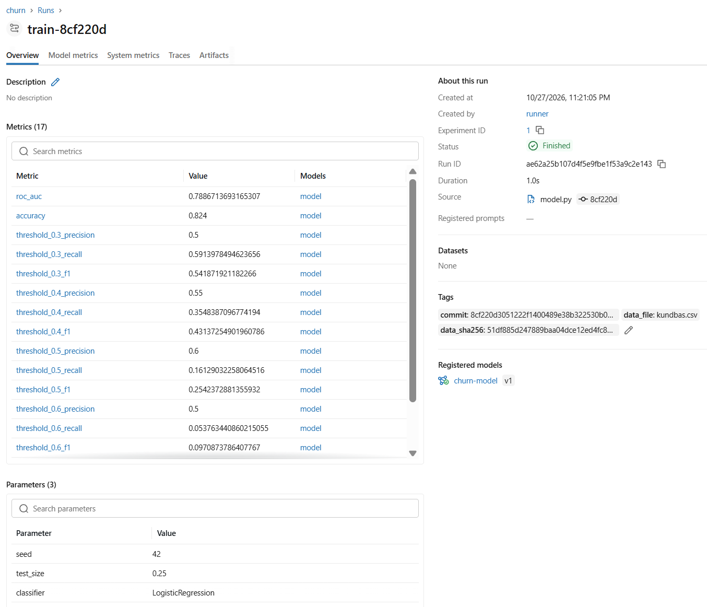
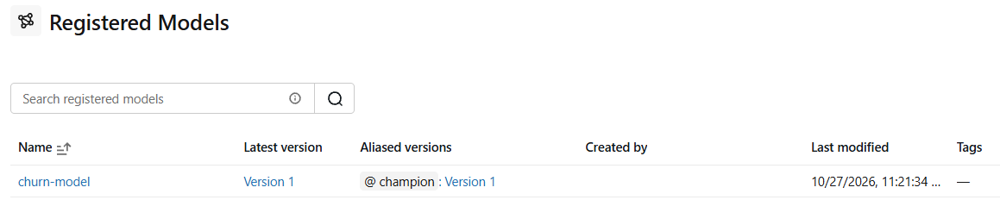

# CI/CD - Pipeline

This repository contains the MLOps pipeline for predicting [customer churn for Saldes Mobil AB](https://github.com/saldes-education/saldes-mobil-churn).
It includes data validation, model training, and an automated CI/CD pipeline.

## 🚀 Quick Start (Local Setup)

This project uses `uv` for lightning-fast dependency management. To set up your local environment:

1. Clone the repository:
   ```bash
   git clone https://github.com/LeoLindqvist123/ci-cd-pipeline.git
   cd ci-cd-pipeline
   ```
2. Sync the environment and install all dependencies (including dev, data and MLflow tracking tools):
   ```bash
   uv sync --all-extras
   ```
3. Run your tests or scripts directly using `uv run`:

```bash
#Example run command
uv run pytest

uv run python  -m churn.model
```


## FastAPI

The API predicts customer churn using the trained model.

Start the API:

```bash
uv run uvicorn churn.api:app --reload
```

Open [http://127.0.0.1:8000/docs](http://127.0.0.1:8000/docs) to test the endpoints.

- `GET /health` — checks model availability.
- `POST /predict` — returns a churn prediction and probability.

Run API tests:

```bash
uv run pytest tests/test_api.py
```


## ✅ Data Validation

The data is validated against a Pandera schema (`validation/schema.py`) in CI. To run it locally:

```bash
uv run python validation/schema.py [path/to/file.csv]
```
If no file is given, `data/kundbas.csv` is used. For example, to validate a new delivery:

```bash
uv run python validation/schema.py data/kundbas_ny_leverans.csv
```

If validation fails, the script lists errors per column and check with a few examples, and exits with code 1, which fails the CI pipeline.

In CI, the `validate` job checks both data files in parallel:

- `kundbas.csv` must **pass**.
- `kundbas_ny_leverans.csv` must **fail**. It is a known-bad delivery that proves the schema catches errors.

The validation job verifies that valid data passes schema validation and known-invalid data is rejected. These expected outcomes are checked in parallel before the training job runs. A separate test verifies that an actual validation-job failure blocks downstream training.

## 📊 Classification Threshold Analysis

The churn model predicts the probability that a customer will leave the company. We evaluate different classification thresholds to understand how they affect the model's predictions.

### What the code does

The function `train_and_evaluate()` in `src/churn/model.py` evaluates five classification thresholds: 0.3, 0.4, 0.5, 0.6, and 0.7.

For each threshold, a customer is classified as likely to churn if their predicted probability is greater than or equal to that threshold.

The model calculates three additional metrics for each threshold:

- **Precision:** Of the customers predicted to churn, how many actually churned?
- **Recall:** Of all customers who actually churned, how many did the model identify?
- **F1-score:** A combined measure of precision and recall.

The existing ROC AUC and accuracy metrics are retained.

### How to run

Run the model training and evaluation module:

```bash
uv run python -m churn.model
```

The evaluation results, including the new threshold-specific metrics, are printed and saved to `outputs/metrics.json`.

### Why it matters

A lower classification threshold may identify more customers who will churn, but it may also produce more false positives. A higher threshold may reduce false positives while missing more actual churners.

Comparing precision, recall, and F1-score helps the team understand these trade-offs before choosing a classification threshold.

The results from different thresholds should be reviewed before selecting a final threshold. For a more rigorous evaluation, select the threshold using validation data and reserve the test data for the final evaluation.

**Note:** Classification thresholds determine how predicted probabilities are converted into churn predictions. They are different from the minimum ROC AUC threshold used by CI to decide whether model evaluation passes or fails.
## 📊 Model Threshold Analysis

The pipeline needs a minimum ROC AUC for the model to pass CI. To choose that
threshold from data instead of guessing, we measured how much ROC AUC varies
with the random seed alone.

### What the script does

`analysis/seed_variance.py` trains and evaluates the model 30 times, with seeds 0–29. The data, features and model stay the same.
Only `SEED` in `churn.model` changes, and it controls the train/test split. Each run therefore evaluates on a different 25 % of the customers.

```bash
uv run python analysis/seed_variance.py
```

### Results (`kundbas.csv`, 30 seeds)

| Statistic          | ROC AUC |
|--------------------|---------|
| Min                | 0.746   |
| Max                | 0.836   |
| Mean               | 0.783   |
| Standard deviation | 0.020   |
| Pipeline (seed 42) | 0.789   |

Seed 42 is close to the mean. The pipeline's fixed seed is therefore representative and not an unusually lucky split.

### Candidate thresholds

All 30 runs use the same data and the same model. They differ only in which
customers end up in the test set. The spread in ROC AUC (0.746 to 0.836) therefore
shows how much the score can vary from the split alone, without any change to the model.

This affects where the threshold can go:

- **Inside the spread:** CI may fail a model simply because of an unlucky split.
- **Far below the spread:** CI may let a model pass even after it has actually got worse.

The table shows how many of the 30 runs would have failed CI with each candidate
threshold. A run fails if its ROC AUC is below the threshold. Since the model was
unchanged between runs, these failures are likely caused by variation in the
train/test split rather than by a worse model. The analysis shows that this
variation exists, but it cannot prove that every future failure has this cause.

| Candidate                    | Threshold | Runs that would fail |
|------------------------------|-----------|----------------------|
| Mean − 1 standard deviation  | 0.763     | 5 / 30               |
| 10th percentile              | 0.760     | 3 / 30               |
| 5th percentile               | 0.751     | 2 / 30               |
| Lowest observed score        | 0.746     | 0 / 30               |
| Mean − 2 standard deviations | 0.743     | 0 / 30               |
| Mean − 3 standard deviations | 0.724     | 0 / 30               |

A lower threshold gives fewer failures caused by the split. The cost is that the
model's quality has to drop more before CI catches it.

### Decision

The CI threshold is set to **ROC AUC ≥ 0.74**, roughly the mean minus two standard deviations.

Motivation:

- **No failures in the analysis.** The threshold is below the lowest observed score (0.746), so none of the 30 runs would have failed CI because of the split alone.
- **Still catches real degradation.** It is only about 0.05 below the pipeline's score (0.789). A clearly worse model would still fail CI.
- **Standard choice.** Mean − 2 SD is a common rule of thumb, while mean − 3 SD (0.724) would let too large a drop through.

The threshold should be revisited if the data, features or model change significantly. In that case, rerun `analysis/seed_variance.py`.

## 📦 Model Versioning & Lineage

Every model that passes the CI quality gate is versioned as a traceable artifact linked to the exact code commit and dataset that produced it.

### How it works
1. **Metadata & Lineage Generation (`src/churn/model.py`):**
   When `uv run python -m churn.model` runs, it generates both the trained model (`outputs/model.joblib`) and a metadata file (`outputs/metrics.json`) containing:
   - **Evaluation metrics:** `roc_auc`, `accuracy`, and threshold-specific metrics (`precision`, `recall`, `f1`).
   - **Commit traceability:** `commit` (populated from `GITHUB_SHA` in GitHub Actions, or `"local"` when run locally).
   - **Data traceability:** `data_file` (`kundbas.csv`) and `data_sha256` (a 64-character SHA-256 hash of the dataset's exact contents).

2. **Gated Versioning in CI (`.github/workflows/ci.yml`):**
   - The `train` job uploads a temporary candidate artifact (`model-candidate-<sha>`, `retention-days: 1`).
   - The `evaluate` job downloads the candidate, writes the metrics and lineage table to the GitHub Actions **Job Summary**, and runs `uv run python -m churn.evaluate`.
   - **Only if the model passes the quality threshold** (`ROC AUC >= 0.74`) does CI publish the official versioned artifact `model-<sha>`.
   - The approved model is also registered in the MLflow Model Registry, see [Experiment Tracking & Model Registry](#-experiment-tracking--model-registry-mlflow).

3. **Automated Lineage Testing (`tests/test_model.py`):**
   The test `test_model_versioning_metadata` verifies that `model.joblib` and `metrics.json` are created with valid `commit`, `data_file`, `data_sha256`, and evaluation metric fields:

   ```bash
   uv run pytest tests/test_model.py
   ```

### Model Artifact Integrity

The pipeline verifies the integrity of the trained model using SHA-256 checksums.

After training, the pipeline saves the model as `outputs/model.joblib` and generates a corresponding `outputs/model.joblib.sha256` checksum file.

Before the model is used, the checksum is verified at the following stages:

- **Evaluation:** verifies the downloaded candidate model before evaluation.
- **Docker packaging:** verifies the approved model artifact before building the image.
- **Call-list generation:** verifies the model before scoring customers.
- **API startup:** verifies the model before loading it into the FastAPI service.

If the model is missing, its checksum is missing, or its contents no longer match the checksum, verification fails. The CI job stops, or the API rejects the model instead of loading it.

Automated tests cover valid artifacts, modified model files, missing files and API behaviour when integrity verification fails.

**Limitation:** This checksum mechanism detects changes when the saved checksum remains trustworthy. It does not independently authenticate the model and checksum if both are replaced.

## 🧪 Experiment Tracking & Model Registry (MLflow)

MLflow is an optional add-on to the versioning above. `metrics.json` and the quality gate in `churn.evaluate` are still the source of truth. MLflow makes every training run searchable and keeps a registry of approved models.

### How it works
1. **Tracking (`src/churn/tracking.py`):**
   When `MLFLOW_TRACKING_URI` is set, `uv run python -m churn.model` logs each training run to the experiment `churn` with:
   - **Params:** `seed`, `test_size`, `classifier`
   - **Metrics:** all numeric values from `metrics.json` (`roc_auc`, `accuracy`, threshold metrics)
   - **Tags (lineage):** `commit`, `data_file`, `data_sha256`
   - **Model:** the trained sklearn pipeline

   The MLflow run id is saved in `outputs/metrics.json` as `mlflow_run_id`, so later steps know exactly which run to register.

2. **Registry (`src/churn/register.py`):**
   `uv run python -m churn.register` reads `mlflow_run_id` from `metrics.json`, registers the model as a new version of `churn-model` and sets the alias `champion`. It should only run after the quality gate has passed. It exits with code 1 if `mlflow_run_id` is missing or if the model could not be registered (for example when `MLFLOW_TRACKING_URI` is not set).

3. **Optional dependency:**
   MLflow is installed as the `tracking` extra (`uv sync --all-extras`). It is not part of the Docker image, since the API only needs `model.joblib`. Without `MLFLOW_TRACKING_URI`, training works exactly as before.

### Run locally
Run from the project root, since `sqlite:///mlflow.db` is a path relative to the current folder:

```bash
MLFLOW_TRACKING_URI=sqlite:///mlflow.db uv run python -m churn.model
MLFLOW_TRACKING_URI=sqlite:///mlflow.db uv run python -m churn.register
uv run mlflow ui --backend-store-uri sqlite:///mlflow.db
```

Open [http://127.0.0.1:5000](http://127.0.0.1:5000). Runs are under the experiment **churn**, and registered versions under **Registered Models → churn-model**. Local MLflow data (`mlflow.db`, `mlruns/`) is ignored by Git and Docker.

### In CI (`.github/workflows/ci.yml`)
- **`train`** sets `MLFLOW_TRACKING_URI` and uploads `mlflow.db` and `mlruns/` together with `outputs/` in the candidate artifact `model-candidate-<sha>`.
- **`evaluate`** runs `churn.register` directly after the quality gate. A model below the threshold is never registered.
- **`evaluate`** uploads `mlflow-tracking-<sha>`, even if the quality gate fails, so anyone in the team can inspect the run (and the registered model, if it passed):

```bash
gh run download <RUN-ID> --pattern "mlflow-tracking-*" --dir ci-mlflow
cd ci-mlflow   # and into the mlflow-tracking-* folder if one was created
uv run mlflow ui --backend-store-uri sqlite:///mlflow.db
```

The CI run is named `train-<short-sha>` and is linked to the exact commit and data hash. For pull requests, the SHA is the merge commit GitHub creates when it tests the branch merged with `main`.





### Tests
```bash
uv run pytest tests/test_tracking.py tests/test_register.py
```
- `test_tracking.py`: no logging when tracking is disabled; a logged run has the expected tags, params and metrics.
- `test_register.py`: no registration when tracking is disabled; a registered model gets version 1 and the `champion` alias; the CLI fails without `mlflow_run_id` and when tracking is disabled.

The tests that use MLflow run against a temporary SQLite database, so they never touch your local `mlflow.db`, and they are skipped if MLflow is not installed.

### Limitations and next steps
- **No shared history between CI runs.** Each pipeline run starts with a new SQLite database, so CI always registers version 1. A central MLflow tracking server (set via `MLFLOW_TRACKING_URI` and a GitHub secret) would keep the history. The code does not need to change for that.
- **Every approved model becomes `champion`.** A natural next step is champion/challenger: a new model only replaces the champion if it is not worse, otherwise it gets the alias `challenger`.

## 🐳 Docker Packaging, Smoke Test & GHCR

The approved churn model and FastAPI service are packaged into a Docker image, verified with an automated smoke test, and published to GitHub Container Registry (`ghcr.io`).

### Build and run locally
Make sure the model has been trained first (`uv run python -m churn.model`), then build and start the container:
```bash
docker build -t churn-api:local .
docker run -d --name churn-test-service -p 8000:8000 churn-api:local
```

### Run the container smoke test
The smoke test (`tests/smoke_test.py`) polls `GET /health` until the container is ready and verifies that `POST /predict` returns a valid prediction (`0` or `1`) and probability (`0.0–1.0`):
```bash
uv run python tests/smoke_test.py http://localhost:8000
docker rm -f churn-test-service
```

### CI/CD & GHCR Publishing
In `.github/workflows/ci.yml`, the `package` job runs after `evaluate`:
1. Downloads the approved `model-<sha>` artifact.
2. Builds the Docker image and runs `tests/smoke_test.py` against the live container.
3. On `push` events to `main`, pushes the verified image to `ghcr.io/leolindqvist123/ci-cd-pipeline/churn-api` tagged with both `<commit-sha>` and `latest`.

### 🚀 Docker Optimization & Resource Management (VG)
To improve operational reliability, container security, and CI resource utilization, the container deployment pipeline was upgraded:
- **Multi-Stage Build:** Uses a `builder` stage for dependencies and creates a minimal `runtime` container without build tools (`/bin/uv`) or temporary caches.
- **Optimized Production Environment:** Installs only production dependencies (`--frozen --no-dev --no-editable`) and strips `__pycache__` and test directories from `.venv`.
- **Buildx GHA Layer Caching:** Integrates `type=gha` caching in CI to reuse unchanged layers across pipeline runs.
- **Security & Health Monitoring:** Runs as a dedicated non-root `appuser` and defines a native container `HEALTHCHECK` against `GET /health`.

#### Before and After Metrics
| Metric | Baseline (Run #76, Single-Stage) | Optimized (Run #96, Multi-Stage + Cache) | Improvement |
|---|---|---|---|
| **Uncompressed Image Size** | ~620 MB (measured one-off baseline) | **~378 MB** (runtime-only, no `uv` or caches) | **~39% smaller** (~242 MB saved) |
| **Build Duration** | 16s (measured one-off baseline) | **11.3s** (cold build) | **~30% faster** |
| **Image Cleanliness** | Included build tools (`uv`) & caches | Stripped `.venv`, runtime-only | Minimal attack surface |
| **Security** | Root user, no healthcheck | `appuser` (non-root) + container `HEALTHCHECK` | Least privilege, orchestration-ready |

## 🛡️ Statistical Data Drift & Safe Data Delivery (VG)

To protect the model from retraining on skewed or incomplete data deliveries that still pass static Pandera schema rules, `src/churn/drift.py` compares incoming deliveries against `data/kundbas.csv`:
- **Volume Sanity Check:** Fails if row count drops below 50% of the reference dataset.
- **Numeric Feature Drift (`MAX_MEAN_SHIFT_STD = 0.50`):** Fails if any raw numeric feature mean shifts by more than 0.50 standard deviations.
- **Unseen Categories:** Fails if new categories appear in `region` or `abonnemang`.
- **Target Rate Drift (`MAX_TARGET_DIFF = 0.15`):** Fails if the churn rate (`avslutat`) shifts by more than 15 percentage points.
- **CI & Local Usage:** Runs in the `validate` job before `train` on `data/kundbas.csv` (expected: pass) and `data/kundbas_drift_leverans.csv` (passes Pandera schema, expected to fail drift check via `uv run python -m churn.drift data/kundbas_drift_leverans.csv data/kundbas.csv`) and is tested via `uv run python -m pytest tests/test_data.py`.

## 📁 Project Structure

```text
ci-cd-pipeline/
├── .github/
│   ├── actions/
│   │   └── setup-project/
│   │       └── action.yml
│   └── workflows/
│       └── ci.yml
├── analysis/
│   └── seed_variance.py
├── data/
│   ├── kundbas.csv
│   ├── kundbas_ny_leverans.csv
│   └── kundbas_drift_leverans.csv
├── validation/
│   └── schema.py
├── docs/
│   ├── fastapi_prediction_prompt.png
│   ├── fastapi_prediction_response.png
│   ├── mlflow_ci_run.png
│   └── mlflow_registry_champion.png
├── outputs/
│   ├── model.joblib
│   ├── metrics.json
│   ├── model.joblib.sha256
│   └── call_list.csv
├── src/
│   └── churn/
│         ├── __init__.py
│         ├── api.py
│         ├── artifact_integrity.py
│         ├── data.py
│         ├── evaluate.py
│         ├── model.py
│         ├── register.py
│         ├── score.py
│         └── tracking.py
├── tests/
│   ├── smoke_test.py
│   ├── test_artifact_integrity.py
│   ├── test_api.py
│   ├── test_data.py
│   ├── test_features.py
│   ├── test_model.py
│   ├── test_register.py
│   └── test_tracking.py
├── create_issues.py
├── issues_followup.json
├── issues.json
├── .dockerignore
├── .gitignore
├── Dockerfile
├── pyproject.toml
├── README.md
└── uv.lock
```

## 🛠️ Development Roadmap & Task Status

*(Team: Please update the status of your assigned tasks below when you merge your PR!)*

### 1. Infrastructure & Setup
- [x] Create project board and generate backlog issues
- [x] Migrate dependency management to `uv` and generate lockfile

### 2. CI/CD & Testing
- [x] Verify branch protection and required status checks
- [x] Set up CI pipeline for code quality (Linting/Formatting)
- [x] Create Pandera schema for data validation
- [x] Set up CI pipeline for Pandera data validation tests
- [x] Set up CI pipeline for model training and unit tests
- [X] Verify that invalid data blocks training in the actual pipeline

### 3. Machine Learning
- [X] Analyze model thresholds and document findings
- [ ] Refine feature engineering pipeline
- [X] Version approved model artifacts with commit and data metadata
- [X] Verify that failing model evaluation prevents publication
- [x] Track experiments and register approved models with MLflow (optional step)

### 4. Model Serving & FastAPI

- [X] Add FastAPI prediction endpoint (`POST /predict`)
- [X] Add health endpoint (`GET /health`)
- [X] Add automated API tests
- [X] Document how to run and test the API locally

### 5. Docker & Artifact Publishing

- [x] Create Dockerfile for the model-serving application
- [x] Build and run the Docker image
- [x] Add a container smoke test
- [x] Push verified images to GitHub Container Registry (GHCR)
- [x] Tag published images with the relevant commit SHA

### 6. Documentation & Final Verification

- [ ] Update README to reflect the completed pipeline
- [ ] Capture a successful end-to-end pipeline run
- [ ] Capture a run where invalid data stops validation
- [ ] Prepare final repository, commit and PR/review links for submission

## 👥 Collaborators

This project is collaboratively developed by:
* [Lilit Ajoyan](https://github.com/LAjoyan)
* [Erfan Tahmasebi](https://github.com/erfantk25-lab)
* [Leo Lindqvist Kröhnert](https://github.com/LeoLindqvist123)
* [Josefin Lesley](https://github.com/Josefin3647)
